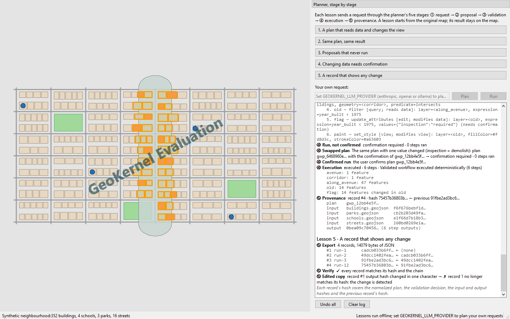

# Agent Planner Basics — how a request becomes a safe, recorded map operation

Five lessons send natural-language map requests through GeoKernel's `NaturalLanguageGisPlanner`, one
stage at a time, and show what each stage guarantees: a plan that runs, the same plan giving the same
result, proposals that never run, confirmation bound to one exact plan, and a provenance record that
shows any change.

The model never runs code or touches the map: it only proposes a workflow, and the host decides what
may run (here: every operation of the viewer executor, without network access or file writes).

```
NaturalLanguageGisPlanner::runWorkflow(request, proposal provider, validation context,
                                       GisWorkflowViewerExecutor step executor, input hashes)
  ─► evaluateWorkflowProposal → validateWorkflow → step executor → AgentExecutionProvenanceStore
```

All application C++ is in `main.cpp`. The inputs recorded with each run are the SHA-256 of the four
data files.



## Build and run

The agent workflow API ships after SDK 1.5.40. Until the next public SDK release, configure with an SDK
built from the GeoKernel sources:

```bat
cd /d D:\projects\GeoKernel.Examples.Qt\AgentPlannerBasics
cmake --preset windows-msvc -DCMAKE_MAKE_PROGRAM=C:/Ninja/ninja.exe -DCMAKE_PREFIX_PATH=C:/Qt/6.11.0/msvc2022_64 -DGEOKERNEL_ROOT=<sdk>
cmake --build --preset windows-msvc-release
outputs\windows\Release\bin\AgentPlannerBasics.exe
```

Configure stops with a clear message when the SDK has no agent workflow API.

**Your own requests** need a model: set `GEOKERNEL_LLM_PROVIDER` (`anthropic`, `openai` or `ollama`),
`GEOKERNEL_LLM_MODEL` and the provider's key (`ANTHROPIC_API_KEY` / `OPENAI_API_KEY`) before starting.
The model receives the request, the layer list with field names and the field notes from
`planner-lessons.json`, never feature data. The lessons need no network access.

`AgentPlannerBasics.exe --screenshot out.png` runs the five lessons, saves the window and the log
(`out.png.txt`) and exits with 0 when every lesson behaved as described. This README's screenshot was
made that way.

## The lessons

Every lesson sends a request through the planner's five stages and writes each stage to the log:

```
① request ─► ② proposal (workflow DSL v2) ─► ③ validation ─► ④ deterministic execution ─► ⑤ provenance
```

A lesson starts from the original map (earlier lesson results are undone); its result stays on the map.

| Lesson | What happens | What it shows |
|---|---|---|
| 1. A plan that reads data and changes the view | "Show the buildings within 150 m of a school in red": `buffer` → `select_by_location` → `set_style` ×2 | The full pipeline: the proposal, the validation decision with each step's category and effects, the step outputs (151 buildings), the provenance record with input and output hashes |
| 2. Same plan, same result | The same plan runs, is undone and runs again | Identical input hashes, identical step output hashes, identical workflow output hash |
| 3. Proposals that never run | Six bad proposals: prose instead of JSON, an operation outside the catalog (`run_python`), an extra `sql` parameter, SQL hidden in a filter expression, a reference to a missing step, a proposal claiming the user confirmed | Each is refused before execution with its code (`agent.planner.proposal_invalid`, `agent.expression.invalid`); nothing runs and nothing is recorded |
| 4. Changing data needs confirmation | "Flag the buildings built before 1975 near the primary avenue for inspection" (`update_attributes`) | Without confirmation nothing runs; the same plan with one value changed gets a different planId, so the first plan's confirmation does not run it; with its own planId it runs (14 buildings flagged in a result layer) |
| 5. A record that shows any change | The provenance export is verified, then a copy with one character of one output hash changed | The intact chain verifies; the edited copy fails at record 1 |

**Your own request** (needs an LLM): type a request and click **Plan**. The model's proposal goes through
the same stages; **Run** (or **Confirm and run** for a plan that changes data) executes exactly the plan
shown. Example with gpt-5.5: "Show the parks with more than 50 trees in dark green" → `filter` →
`set_style` → `zoom_to`, 3 parks.


## Data

The synthetic neighbourhood of the AgentMapAssistant example (352 buildings, 4 schools, 3 parks,
16 streets, EPSG:4326; street names borrowed from Kadıköy, Istanbul, geometry and attributes invented)
and `planner-lessons.json`, which holds every prepared and bad proposal. Edits always go to result
layers in memory; the GeoJSON files are never modified.

## Related

- AgentMapAssistant: the same pipeline as a chat assistant with plan preview and undo
- ADR-0007: agent workflow DSL v2, effects, confirmation, provenance
