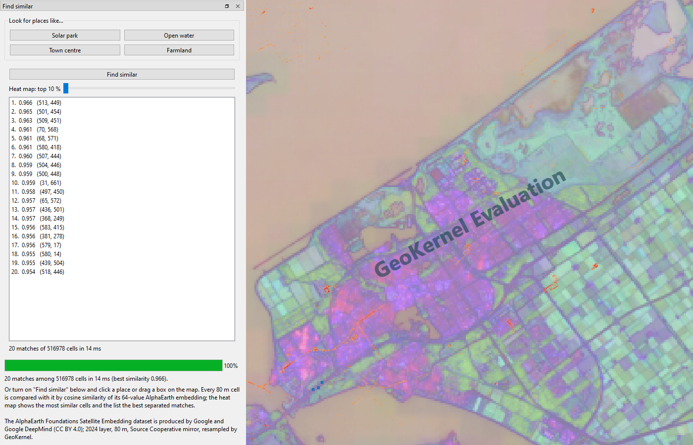

# Find similar — scan a province for places like this one

Pick a solar park, a lake, a town centre or a field (or click any place, or drag a box) and every
80 m cell of Flevoland is ranked by how much it looks like it. The ranking uses AlphaEarth
satellite embeddings: 64 numbers per cell that summarise a year of observations. No model runs
and nothing is trained; a search over 517 000 cells takes about 15 ms.

```
AlphaEarth 2024 embeddings (64 per 80 m cell, GeoKernel.SampleData, 31 MB)
  ─► GisSimilaritySearch     cosine similarity of every cell to the query (a cell or a box mean)
  ─► GisLayerSimilarity      heat map of the most similar cells, over the embeddings shown as false colour
  ─► GisSimilarityPanel      click / drag on the map, threshold, ranked matches (click to zoom)
```

All application C++ is in `main.cpp`; asset download is in `ModelDownload.h`.



## Build and run

The find-similar API ships after SDK 1.5.40. Until the next public SDK release, configure with
an SDK built from the GeoKernel sources:

```bat
cd /d D:\projects\GeoKernel.Examples.Qt\SimilaritySearch
cmake --preset windows-msvc -DCMAKE_MAKE_PROGRAM=C:/Ninja/ninja.exe -DCMAKE_PREFIX_PATH=C:/Qt/6.11.0/msvc2022_64 -DGEOKERNEL_ROOT=<sdk>
cmake --build --preset windows-msvc-release
outputs\windows\Release\bin\SimilaritySearch.exe
```

Configure stops with a clear message when the SDK has no `GisSimilaritySearch`.

**Data.** At startup the example downloads `flevoland_alphaearth_2024_80m_v1.zip` from
GeoKernel.SampleData v1 (31 MB, SHA-256 checked, cached under the user's cache folder): 746 × 693
cells of 80 m in EPSG:32631, 64 bands, written by `GeoKernel.Cloud::EmbeddingCollection`.

`SimilaritySearch.exe --screenshot out.png` searches the solar park, zooms to Almere, saves the
window and exits (used for this README).

## Workflow

1. The map shows the embedding grid itself, its first three dimensions as muted false colour:
   polders, towns, water and woods already stand apart.
2. **Look for places like…** runs a preset query:
   - **Solar park**: the mean embedding of Zonnepark Zuyderzon (Almere, about 700 × 700 m,
     OpenStreetMap outline). The other large solar parks of Flevoland rank in the top 1 % of
     cells (De Boomgaard in the top 0.01 %, Parkway6 0.2 %, A27 / Groene Kadeweg / Symbizon
     under 1 %); parks smaller than a cell are not found at 80 m.
   - **Open water** (Markermeer), **Town centre** (Almere Stad), **Farmland** (Oostelijk
     Flevoland): one cell each.
3. Or press **Find similar** and click a place (its cell) or drag a box (the mean of its cells).
4. The heat map shows cells at or above the threshold (0.9 here; the slider sets it, 0 = top
   10 %), the outlines and the list show the 20 best matches kept two cells apart. Click a
   match to zoom to it.

## Data credit

The AlphaEarth Foundations Satellite Embedding dataset is produced by Google and Google
DeepMind (CC BY 4.0). 2024 layer, Source Cooperative mirror; GeoKernel read the 80 m overview,
de-quantized it and resampled it to one grid.
