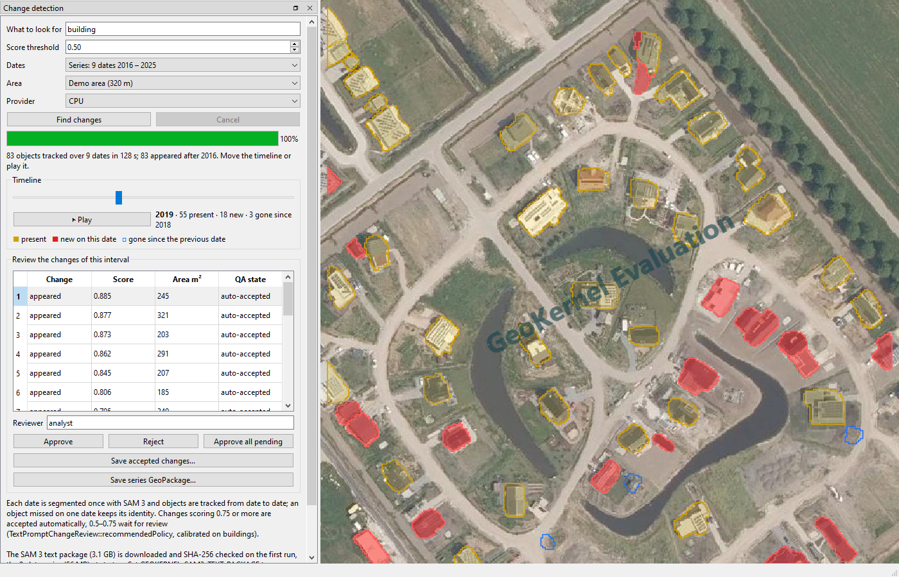

# Text-prompt change detection — what changed, for anything you can name

Type what to look for ("building", "greenhouse", "solar panel") and see where it appeared
and disappeared between dates, year by year, with a review queue before anything is saved.
No model trained per class and no pixel differencing: SAM 3 segments the concept from text on
every date and GeoKernel tracks the objects from date to date.

```
prompt + dates ─► TextPromptChangeSeries::run   one SAM 3 pass per date, objects tracked
              ─► per-interval changes           appeared / disappeared, with SAM 3 scores
              ─► AiQaReviewWorkflow              auto-accept ≥ 0.75, review 0.5–0.75 (audit trail)
              ─► timeline                        TemporalPlaybackController + TemporalFeatureIndex
              ─► GeoPackage                      accepted changes, or the whole series
```

All application C++ is in `main.cpp`; asset download is in `ModelDownload.h`.



## Build and run

The change series API ships after SDK 1.5.40. Until the next public SDK release,
configure with an SDK built from the GeoKernel sources:

```bat
cd /d D:\projects\GeoKernel.Examples.Qt\TextPromptChangeDetection
cmake --preset windows-msvc -DCMAKE_MAKE_PROGRAM=C:/Ninja/ninja.exe -DCMAKE_PREFIX_PATH=C:/Qt/6.11.0/msvc2022_64 -DGEOKERNEL_ROOT=<sdk>
cmake --build --preset windows-msvc-release
outputs\windows\Release\bin\TextPromptChangeDetection.exe
```

Configure stops with a clear message when the SDK has no `TextPromptChangeSeries`. Once the
next SDK is published the `-DGEOKERNEL_ROOT` argument is no longer needed.

**Data.** At startup the example downloads the 9-date Almere / Oosterwold series (56 MB,
SHA-256 checked, cached under the user's cache folder). On the first **Find changes** it
downloads the SAM 3 text package (3.1 GB, every file SHA-256 checked); set
`GEOKERNEL_SAM3_TEXT_PACKAGE` to the folder of an installed package to skip that.

`TextPromptChangeDetection.exe --screenshot out.png` runs the demo area, shows 2019, saves
the window and exits (used for this README).

## Workflow

1. The map shows the 2016 orthophoto of a 1 km² area that develops from fields into a
   residential district between 2017 and 2022.
2. Enter what to look for and a score threshold, pick **Two dates** (2016 → 2025) or the
   **Series** (9 dates: 2016–2020, 2022–2025; the provider has no 2021 layer), the **Demo
   area** (320 m, about 2 minutes on CPU for the series) or the **Full dataset**, and a
   provider. **Find changes** runs on a worker thread; **Cancel** stops after the current
   tile and keeps the previous result.
3. The **timeline** shows each date: objects present on it in yellow, those new on that date in
   red, those gone since the previous date as blue outlines. **Play** steps through the dates
   with `TemporalPlaybackController` (`TextPromptChangeSeries::playbackOptions`), and the frame's
   visible objects come from a `TemporalFeatureIndex` over `TextPromptChangeSeries::timeline`.
4. The table lists the changes of the interval ending at the shown date with their SAM 3 score,
   area and QA state. Changes scoring 0.75 or more are accepted automatically, 0.5–0.75 wait
   for review (`TextPromptChangeReview::recommendedPolicy`), weaker ones are filtered. Select a
   row to zoom to it; enter your name and **Approve**, **Reject** or **Approve all pending**.
   Every decision is recorded in the review's hash-chained audit trail.
5. **Save accepted changes** writes the auto-accepted and approved changes of the interval to a
   GeoPackage or GeoJSON (EPSG:25831, with change, score, area, QA state and reviewer).
   **Save series GeoPackage** writes every object's lifespan (`objects`, date fields) and every
   interval's changes (`changes`).

## Method and limits

Each date is segmented once; an instance continues the object it overlaps best (IoU ≥ 0.3 or
covering half of the smaller one), so a mask split or merged differently on another date is not
change. An object missed on one date and found again keeps its identity (`maximumGap` 1).
Measured on this area against the Dutch building register BAG (445 buildings built 2017–2025):
the objects that appeared after 2016 match BAG at precision 0.71, recall 0.70 (IoU 0.3), and
78 % of the matched buildings appear within a year of their registered construction year. In
stable years (after 2022) the few real changes are outnumbered by single-date noise, so review
those intervals. Thresholds are prompt-specific: small objects such as solar panels in 0.5 m
imagery need a threshold around 0.2. Results are predictions, not ground truth.

## Data and licenses

Imagery: Beeldmateriaal Nederland / PDOK annual orthophotos 2016–2025, CC BY 4.0, rendered
on a 0.5 m EPSG:25831 grid (`almere_oosterwold_series_2016_2025_v1.zip`, GeoKernel.SampleData).
Annual layer years are not verified flight dates; the example uses 1 July as a nominal date.
Model: Meta SAM 3 text package, SAM License; retain the package notices.
